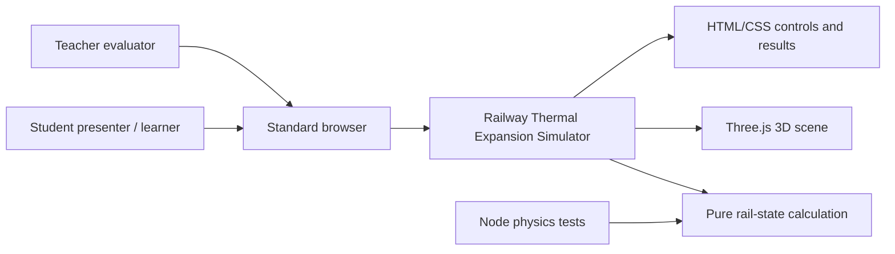

<!--
Source: sdlc-studio/prd.md
This TRD records the implementation design for the approved lean MVP.
-->
# Technical Requirements Document

**Project:** railway-thermal-expansion-simulator  
**Version:** 1.1  
**Status:** Draft  
**Last Updated:** 2026-11-02  
**PRD Reference:** [PRD](prd.md)

---

## 1. Executive Summary

### Purpose

Define the smallest maintainable browser architecture for a single-page interactive 3D railway thermal-expansion simulator. The implementation must keep the scientific calculation deterministic and testable while sharing one calculated state between the HTML results and Three.js scene.

### Scope

This TRD covers a local-first browser application built with Vite, vanilla JavaScript, HTML/CSS, and Three.js. It covers the physics module, UI state flow, 3D scene, accessibility, failure handling, testing, and local/static deployment.

It does not cover accounts, a backend, data persistence, APIs, databases, train simulation, finite-element analysis, real heat transfer, physical buckling, or a multi-page application.

### Key Decisions

- Use a single client-side deployable with clear internal module boundaries.
- Keep the physics calculation pure and independent of Three.js and the DOM.
- Use exactly three primary controls and one shared calculated state for all visible outputs.
- Use basic Three.js geometry and an explicitly labelled exaggerated movement scale.
- Use Node’s built-in test runner for deterministic physics tests and browser verification for integrated UI/scene behavior.

---

## 2. Project Classification

**Project Type:** Web Application

**Classification Rationale:** The product is a browser-based interactive visual application with a user-facing 3D interface and no required server-side API.

**Architecture Implications:**

- **Default Pattern:** Monolith / single deployable for a small web application.
- **Pattern Used:** Modular client-side application.
- **Deviation Rationale:** The product remains one deployable browser app, but separates pure physics, scene rendering, UI orchestration, and styling so the calculation can be tested without a browser and the scene cannot become the source of truth.

---

## 3. Architecture Overview

### System Context



The browser loads a static bundle. Users manipulate the three approved controls. The application calculates a rail state once per input change, then sends that state to both the results panel and the 3D scene.

### Architecture Pattern

**Modular client-side monolith**

**Rationale:** A single local/static application is sufficient for a classroom exhibit. Internal modules provide the needed separation without introducing a backend, service boundaries, state-management library, or deployment complexity.

### Component Overview

| Component | Responsibility | Technology |
|---|---|---|
| Application shell | Bootstraps the app, handles startup errors, and connects modules | Vite, vanilla JavaScript |
| Physics module | Stores material constants and calculates signed expansion, gap, and status | Pure JavaScript |
| UI controller | Reads controls, validates/clamps input ranges, renders results and explanations | HTML, CSS, vanilla JavaScript |
| 3D scene module | Creates rails, sleepers, joint, camera, lighting, heat colors, and smooth movement | Three.js |
| Physics test suite | Verifies equation, unit conversion, closure, and edge cases | Node built-in test runner |

### State Flow

```text
control input
    -> normalized input state
    -> calculateRailState(input)
    -> shared rail state
       -> results panel
       -> status explanation
       -> 3D rail positions and gap indicator
       -> temperature color
```

`scene.js` must not recalculate physics independently. `main.js` owns the orchestration and passes the same calculated state to UI and scene rendering functions.

---

## 4. Technology Stack

### Core Technologies

| Category | Technology | Version | Rationale |
|---|---|---|---|
| Language | JavaScript | Modern browser JavaScript | Explicitly approved by the proposal; sufficient for a small client-side exhibit without a type-system migration. |
| Build tool | Vite | Pin during implementation | Provides a small local development server and production browser bundle with minimal configuration. |
| 3D rendering | Three.js | Pin during implementation | Directly supports browser-based camera orbit, zoom, geometry, lighting, materials, and animation. |
| Markup/styling | HTML/CSS | Browser standard | Keeps controls accessible and avoids a UI framework for a single screen. |
| Unit testing | Node built-in test runner | Match supported Node runtime | Avoids adding a test framework for pure calculation tests. |

No React, TypeScript, state-management library, CSS framework, physics engine, or server framework is permitted for the MVP without a recorded change to the PRD/TRD.

### Build & Development

| Tool | Purpose |
|---|---|
| Visual Studio Code | Approved development environment |
| Codex | Approved AI-assisted development tool; usage must be declared in project documentation |
| npm | Dependency installation and script execution |
| Vite dev server | Local browser demonstration |
| Node test runner | Physics unit tests |

The implementation must document exact `npm` commands in `README.md` after `package.json` is created.

### Infrastructure Services

None required. Development and demonstration run locally. A static hosting service may be used later only if it serves the generated browser assets without adding runtime dependencies.

---

## 5. API Contracts

### API Style

None. The MVP has no HTTP API or server endpoint.

### Authentication

None. The app is a public local exhibit with no user accounts.

### Endpoints Overview

No endpoints.

### Internal Module Contract

The physics module must expose a pure function equivalent to:

```js
calculateRailState({ material, temperatureC, initialGapMm })
```

It returns a serializable state containing at least:

```js
{
  material,
  coefficientPerC,
  temperatureC,
  initialGapMm,
  railLengthM: 10,
  referenceTemperatureC: 25,
  deltaTemperatureC,
  expansionMm,
  signedGapMm,
  remainingGapMm,
  status
}
```

The returned `expansionMm` is signed. `remainingGapMm` is clamped to zero for display. `signedGapMm` determines whether the status is Open or Closed / Insufficient clearance.

### Error Response Format

There is no network error contract. Invalid internal state must fail clearly during development/tests. A Three.js initialization failure must render a readable user-facing message in the application shell.

---

## 6. Data Architecture

### Data Models

#### Material Definition

| Field | Type | Constraints | Description |
|---|---|---|---|
| `id` | string | `steel`, `aluminum`, or `copper` | Stable internal material identifier |
| `name` | string | One of the three approved names | User-facing material name |
| `coefficientPerC` | number | Positive fixed constant | Approximate linear expansion coefficient |
| `swatch` | string | Display-only | Material identity cue; must not replace heat coloring |

#### Simulator Input State

| Field | Type | Constraints | Description |
|---|---|---|---|
| `temperatureC` | number | 10–100 inclusive | Selected rail temperature |
| `initialGapMm` | number | 0–15 inclusive | Initial expansion joint gap |
| `material` | Material ID | Exactly three choices | Selected rail material |

#### Calculated Rail State

| Field | Type | Constraints | Description |
|---|---|---|---|
| `deltaTemperatureC` | number | `temperatureC - 25` | Signed temperature difference |
| `expansionMm` | number | Signed | `1000 × α × 10 × (T − 25)` |
| `signedGapMm` | number | May be negative | `initialGapMm - expansionMm` |
| `remainingGapMm` | number | `>= 0` | `max(0, signedGapMm)` |
| `status` | string | `Open` or `Closed / Insufficient clearance` | Derived from signed gap |

### Storage Strategy

| Data Type | Storage | Rationale |
|---|---|---|
| Current controls and calculated state | In-memory JavaScript state | No persistence is required and a reload may safely restore defaults. |
| Material constants and fixed assumptions | Source code constants | They are part of the approved scientific model, not user data. |
| User/session data | None | Accounts and analytics are out of scope. |

### Migrations

None. There is no persistent schema.

---

## 7. Integration Patterns

### External Services

None at runtime.

### Event Architecture

No distributed events. DOM `input`/`change` events trigger a synchronous calculation and an animated scene transition. The render loop is limited to visual interpolation and camera interaction; it must not alter the physics result.

### Browser Boundaries

- HTML controls are the accessible input boundary.
- Three.js is the rendering boundary.
- `calculateRailState()` is the deterministic domain boundary.
- Startup catches rendering initialization failures and exposes them in the application shell.

---

## 8. Infrastructure

### Deployment Topology

```text
Developer laptop
  -> Vite development server
  -> standard browser

Optional static host
  -> generated Vite assets
  -> standard browser
```

There is no runtime server, database, queue, or external API.

### Environment Strategy

| Environment | Purpose | Characteristics |
|---|---|---|
| Development | Build and test locally | Node/npm, Vite dev server, Node unit tests |
| Demonstration | Classroom exhibit | Local Vite server or static bundle in a standard browser |
| Production | Not required for MVP | Any future static hosting must preserve no-runtime-service assumptions |

### Scaling Strategy

No server scaling is required. Client performance is protected by a small scene, basic geometry, no imported assets, and no unnecessary particle or physics engine.

### Recovery

Reloading the page resets the in-memory state to defaults. A readable startup error is required when the 3D renderer cannot initialize.

---

## 9. Security Considerations

### Threat Model

| Threat | Likelihood | Impact | Mitigation |
|---|---|---|---|
| Malicious or unreliable third-party asset | Low | Medium | Do not use imported 3D assets or paid runtime assets; keep dependencies minimal and pinned. |
| Dependency supply-chain issue | Low | Medium | Use only required Vite/Three.js dependencies, review lockfile changes, and avoid unnecessary packages. |
| Misleading scientific output | Medium | High for assessment credibility | Test the pure equation, show assumptions, use signed values correctly, and explicitly state model limits. |
| Inaccessible interaction | Medium | Medium | Use native labelled controls, keyboard operation, adequate contrast, and text status independent of color. |
| Blank page on 3D failure | Medium | Medium | Catch initialization failures and render readable fallback text. |

### Security Controls

| Control | Implementation |
|---|---|
| Authentication | None; no protected data exists. |
| Authorisation | None; all app behavior is public. |
| Encryption at rest | Not applicable; no stored user data. |
| Encryption in transit | Not required for local runtime; static hosting must use platform HTTPS if later deployed. |
| Secrets | No secrets or environment credentials are required. |

---

## 10. Performance Requirements

### Targets

| Metric | Target | Measurement |
|---|---|---|
| Input-to-results update | Immediate for classroom use | Browser interaction check after each control change |
| Input-to-visible movement | Smooth transition without blocking UI | Browser interaction check and visual review |
| Render complexity | Basic geometry and lightweight animation only | Code review and browser smoke test |
| Startup | Loads on an ordinary classroom laptop without a backend | Local cold-start browser check |
| Runtime availability | Works for the duration of a short live demonstration | End-to-end exhibit smoke test |

No numeric latency or throughput SLA is required for this low-stakes local exhibit. If interaction becomes visibly laggy, reduce scene complexity before introducing a framework or service.

---

## 11. Architecture Checklist

- [x] Project type is classified as a Web Application.
- [x] Single client-side deployable is appropriate for the MVP.
- [x] Physics is isolated from rendering and DOM concerns.
- [x] The same calculated state drives numerical output and visual output.
- [x] No unnecessary backend, API, database, account, or persistence layer is introduced.
- [x] Exactly three primary controls are preserved.
- [x] Material identity and temperature heat map are separate visual concepts.
- [x] Accessibility and startup failure handling are explicit requirements.
- [x] Physics examples and edge cases have a test strategy.
- [x] Dependency and asset scope is minimal.

---

## 12. Architecture Decision Records

### ADR-001: Use a modular vanilla JavaScript client-side application

**Status:** Accepted

**Context:** The exhibit needs interactive browser UI, 3D rendering, and testable calculations, but no backend or complex application state.

**Decision:** Use Vite with vanilla JavaScript, HTML/CSS, and clear modules for physics, scene, and orchestration.

**Consequences:**

- Positive: Small dependency surface, direct browser behavior, easy local demonstration, and clear separation for tests.
- Positive: Avoids framework and state-management overhead for one screen.
- Negative: The project must maintain its own small UI/rendering conventions.

### ADR-002: Keep the physics calculation pure

**Status:** Accepted

**Context:** The numerical model is the scientific contract and must be reproducible independently of animation or browser state.

**Decision:** Implement `calculateRailState()` as a pure function with fixed constants and explicit unit conversion.

**Consequences:**

- Positive: Deterministic unit tests can cover equations and edge cases before 3D work.
- Positive: UI and scene cannot silently disagree by reimplementing the formula.
- Negative: The orchestration layer must pass and apply one shared state consistently.

### ADR-003: Use basic Three.js geometry with exaggerated visual movement

**Status:** Accepted

**Context:** Real thermal movement is too small to see clearly in a classroom scene, and imported assets or advanced simulation are out of scope.

**Decision:** Build rails, sleepers, joint, and indicators from basic geometry. Apply a clearly labelled visual exaggeration factor only to rendered movement; never to numerical calculations.

**Consequences:**

- Positive: The physical concept is visible and the implementation remains small.
- Positive: Numerical outputs stay scientifically consistent with the approved model.
- Negative: The scene must repeatedly communicate that the visual movement is exaggerated.

### ADR-004: No runtime API or persistence

**Status:** Accepted

**Context:** The app is a local classroom exhibit with no user accounts, shared data, or server-backed behavior.

**Decision:** Ship a static client-side bundle with in-memory state only.

**Consequences:**

- Positive: Simple setup, no secrets, no database, no network failure dependency.
- Negative: User selections are lost on reload and cannot be shared or stored, which is acceptable for the MVP.

---

## 13. Open Technical Questions

- [ ] **Q:** Which Node.js version should be recorded as the project minimum when `package.json` is created?
  **Context:** The approved scope requires Node’s built-in test runner, but no runtime version is fixed yet.
- [ ] **Q:** Which browser smoke-test tool, if any, should be used for integrated UI verification?
  **Context:** Physics tests are specified, while the browser verification mechanism remains to be selected during implementation.
- [ ] **Q:** Which credible source should be cited for the approximate material coefficients?
  **Context:** This is required for the final binder and scientific documentation, though it does not change the MVP calculation constants.

---

## 14. Implementation Constraints

### Must Have

- Use JavaScript, Vite, vanilla HTML/CSS, and Three.js as the default implementation.
- Preserve the exact three-control scope and ranges.
- Keep `calculateRailState()` pure and test it before implementing the 3D scene.
- Use fixed `L₀ = 10 m`, `T₀ = 25°C`, and the three approved approximate coefficients.
- Drive UI and scene from one calculated state.
- Keep closed-gap behavior physically honest: display zero physical gap and explain insufficient clearance without simulating overlap or buckling.
- Make controls keyboard-operable and results understandable without color alone.
- Document local run commands, formulas, assumptions, exaggerated scale, and AI use.

### Won't Have (This Version)

- Backend, API, database, accounts, persistence, analytics, or cloud dependency.
- React, TypeScript, state-management library, CSS framework, physics engine, or imported 3D assets.
- Train movement, railway network simulation, finite-element analysis, stress/force/buckling prediction, fluid dynamics, or full heat-transfer solver.
- Extra sliders for rail length, insulation, train speed, or heat flux.

---

## Changelog

| Date | Version | Changes |
|---|---|---|
| 2026-11-02 | 1.1 | Created technical design from the approved PRD. |
